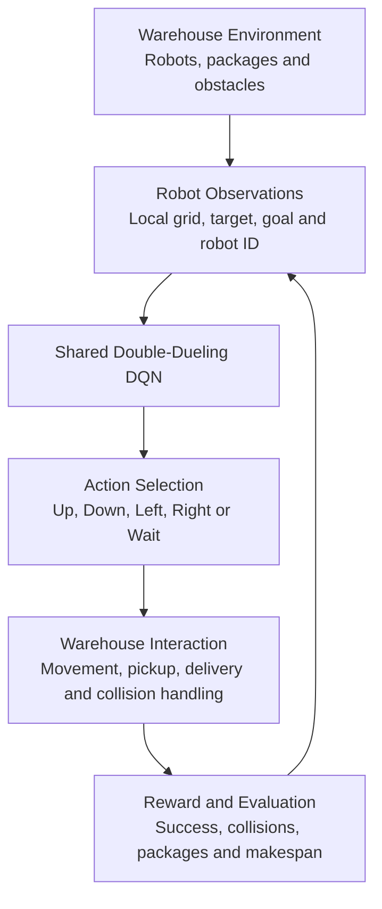

# Multi-Robot Warehouse Coordination Using Deep Reinforcement Learning

## About the Project

How can multiple robots work together in a warehouse without blocking each other?

That was the main question behind this project.

I developed a simulated warehouse environment where multiple robots collect their assigned packages and deliver them to their destinations. The challenge is that they share narrow aisles and need to avoid obstacles, collisions and deadlocks while completing their tasks.

To explore this problem, I implemented a multi-robot environment using Python and Gymnasium and experimented with different approaches, including Independent DQN and Shared Double-Dueling DQN.

The main objective was to investigate whether sharing a learning model could help robots coordinate more effectively.

## Project Objectives

- Build a warehouse simulation with multiple robots, packages and obstacles.
- Enable robots to collect and deliver their assigned packages.
- Handle collisions, shared destinations and position swaps.
- Compare different reinforcement learning approaches.
- Investigate how performance changes when the number of robots increases.

## Environment

The warehouse environment includes:

- Multiple robots with individual package assignments.
- Static obstacles and narrow shared aisles.
- Five possible actions: Up, Down, Left, Right and Wait.
- Collision handling for robots attempting to enter the same cell or swap positions.
- Rewards for package collection, delivery, progress and collision avoidance.

## Project Workflow

The following diagram illustrates how the robots interact with the warehouse and how the shared learning model selects actions.



## Algorithms Compared

| Algorithm | Description |
|---|---|
| Random Policy | Selects valid actions randomly |
| BFS-based Shortest Path | Uses shortest-path distances without coordinating with other robots |
| Independent DQN | Each robot learns using its own network |
| Shared Double-Dueling DQN | Robots use a shared learning network |

## Experimental Results

In the reported two-robot comparison experiment, the shared DQN achieved the highest success rate among the four approaches.

| Metric | Random | Shortest Path | Independent DQN | Shared DQN |
|---|---:|---:|---:|---:|
| Success rate | 0.05 | 0.49 | 0.54 | **0.80** |
| Collisions / episode | 7 | 150 | 15 | **11** |
| Makespan (steps) | 147 | 83 | 78 | **43** |

*Values are taken from the project's comparison chart.*

### Performance Comparison


### Scalability

The scalability experiment investigates how the approach performs with different numbers of robots. It also examines curriculum training, where a policy trained with two robots is adapted to a four-robot environment.


### Training Performance

The training curves show how the agent's performance changes during learning.


## Simulation Examples

The following simulations show robots navigating the warehouse, collecting packages and interacting in shared aisles.

### Two-Robot Simulation


### Four-Robot Simulation


## What I Learned

A few observations stood out during the experiments:

- Robots can learn to wait and yield instead of repeatedly trying to enter a narrow shared aisle.
- Sharing network parameters allows robots to learn from experiences collected by multiple agents.
- Reward design has an important influence on task completion and collision behaviour.
- A policy that works in one warehouse layout does not necessarily generalise to a different layout.

## Technologies Used

- Python
- PyTorch
- Gymnasium
- NumPy
- Matplotlib
- Deep Q-Networks (DQN)
- Double DQN
- Dueling DQN

## Project Structure

```text
multi-robot-warehouse-reinforcement-learning/
├── README.md
├── requirements.txt
├── notebooks/
│   └── multi_robot_rl_pickup.ipynb
├── report/
│   └── final_project_report.pdf
├── results/
│   ├── comparison_2_robots.png
│   ├── scalability.png
│   ├── training_curves.png
│   └── simulations/
│       ├── simulation_aisle_2.gif
│       └── simulation_aisle_4.gif
└── src/
```

## How to Run

Clone the repository:

```bash
git clone YOUR_REPOSITORY_URL
```

Install the required dependencies:

```bash
pip install -r requirements.txt
```

Open the notebook in Jupyter Notebook or Google Colab and run the cells to create the environment, train the agents and evaluate their performance.

## Limitations and Future Work

The current environment uses a discrete grid rather than continuous robot movement. Package assignments are predefined, and the environment uses simplified robot dynamics.

Future improvements could include:

- Testing more advanced coordination approaches such as QMIX.
- Exploring recurrent reinforcement learning.
- Introducing moving obstacles.
- Allowing robots to allocate packages dynamically.
- Testing on larger and previously unseen warehouse layouts.

## Project Report

The complete project report is available in the `report/` folder.

---

**Academic project:** Introduction to Reinforcement Learning

**Project:** Multi-Robot Pick-and-Deliver with Obstacle and Collision Avoidance in Shared Aisles
